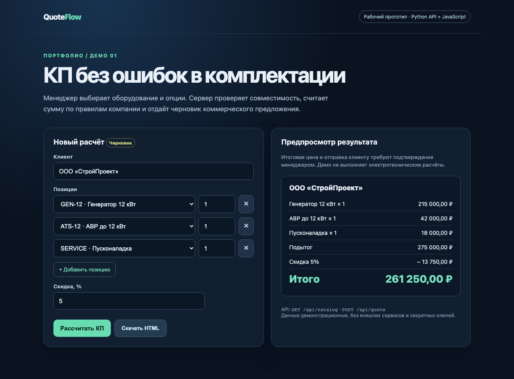
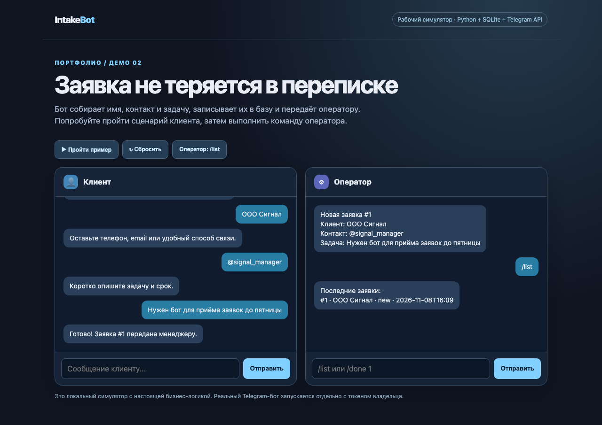

# Python / JS — два демонстрационных проекта

Это новые рабочие демо для портфолио. Они показывают код, тесты и сценарии, которые можно адаптировать под заказчика. Это **не** клиентские внедрения и не заявка на подтверждённый коммерческий результат.

| Проект | Что делает | Стек | Демо |
|---|---|---|---|
| [QuoteFlow](quote-flow/) | Считает черновик КП и проверяет совместимость выбранных опций | Python, HTTP API, JavaScript | [Видео](media/quote-flow-demo.mp4) |
| [IntakeBot](intake-bot/) | Собирает заявку, записывает в SQLite и уведомляет оператора | Python, SQLite, Telegram Bot API | [Видео](media/intake-bot-demo.mp4) |

## QuoteFlow



```bash
cd quote-flow
python3 server.py
# http://127.0.0.1:8765
python3 -m unittest -v test_quote.py
```

При генераторе `GEN-12` попробуйте выбрать `ATS-20`: сервер отклонит несовместимую комбинацию. Внешние сервисы и секретные ключи для демо не нужны.

## IntakeBot



```bash
cd intake-bot
python3 demo_server.py
# http://127.0.0.1:8766
python3 -m unittest -v test_core.py
```

Веб-симулятор вызывает ту же бизнес-логику, что Telegram-адаптер. Для запуска в реальном Telegram нужен токен владельца; инструкция находится в [README проекта](intake-bot/README.md).

## Готовая страница портфолио

Статические файлы для GitHub Pages находятся в [`docs/`](docs/). На странице есть оба коротких видео и архив исходников.

## Проверка

Оба сценария проверены в браузере. Шесть модульных тестов прошли. Демонстрационные данные не являются инженерной спецификацией или реальными клиентскими данными.
